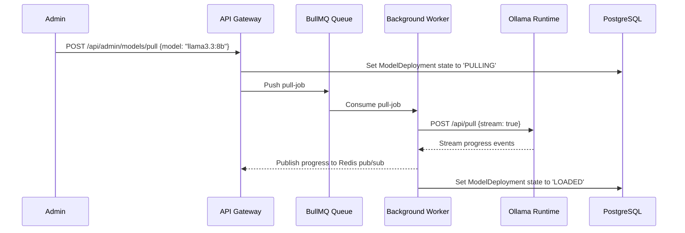

# Phase 03: Model Registry & Lifecycle Engine

## 1. Objective
Implement the complete PostgreSQL schema using Prisma ORM, seed the foundational model catalog, and build the asynchronous model lifecycle engine that handles discovery, background downloading (via BullMQ), layer verification, and dynamic model status updates.

---

## 2. Deliverables Checklist
- [ ] Complete Prisma Schema in `packages/database/prisma/schema.prisma`:
  - Entities: `User`, `UserProfile`, `Session`, `ApiKey`, `Model`, `ModelVersion`, `ModelWorker`, `ModelDeployment`, `ApiRequest`, `UsageRecord`, `UserQuota`, `AuditLog`.
- [ ] Database migration pipeline and initial migration generation.
- [ ] Model Seed Script: `scripts/seed-models.ts` populating default models:
  - Llama 3.3 (8B, 70B)
  - Qwen 2.5 Coder (7B, 14B, 32B)
  - DeepSeek R1 Distill (8B, 14B, 32B)
  - Nomic Embed Text (v1.5)
- [ ] Backend `ModelsModule` in `apps/api`:
  - `GET /v1/models`: OpenAI-compatible model listing.
  - `GET /v1/models/:model_id`: Model detail and capability metadata.
  - `POST /api/admin/models/pull`: Enqueue background pull job.
- [ ] Background BullMQ Job in `apps/worker`:
  - `ModelDownloadProcessor`: Connects to Ollama `/api/pull`, tracks layer progress, updates DB state (`PULLING` -> `LOADED`).

---

## 3. Core Workflow

---

## 4. Acceptance Criteria
1. Prisma migrations apply cleanly to PostgreSQL.
2. Initial models seed into the database with accurate parameter counts, context windows, and license info.
3. `/v1/models` returns valid OpenAI-formatted list.
4. Triggering a model pull successfully delegates to Ollama and marks the deployment as `LOADED` when complete.

