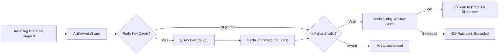

# Phase 05: API Key Management & Fast Guard

## 1. Objective
Build the cryptographic API key subsystem and high-throughput validation middleware. Keys must be verified in under $1\text{ ms}$ using Redis caching, with sliding-window rate limiting protecting downstream inference workers.

---

## 2. Deliverables Checklist
- [ ] API Key Cryptography Service:
  - Format: `sk_live_<prefix_8_chars>_<random_entropy_32_chars>`.
  - Hashing: Store only `SHA-256(complete_key)` in PostgreSQL; raw secret is shown **once** upon creation.
  - Masking: Generate display mask (e.g., `sk_live_a7f9...c83b`).
- [ ] Key Management Endpoints (`/api/keys`):
  - `POST /api/keys`: Create new API key with custom name, optional expiration, and allowed model restrictions.
  - `GET /api/keys`: List user's active keys (masked format) and usage timestamps.
  - `DELETE /api/keys/:id`: Immediately revoke key and evict from Redis cache.
- [ ] High-Speed `ApiKeyAuthGuard`:
  - Intercepts `Authorization: Bearer sk_live_...`.
  - Checks Redis cache (`key:hash -> metadata`) with $300\text{ s}$ TTL.
  - Fallbacks to DB query on cache miss and re-populates cache.
- [ ] Distributed Rate Limiter:
  - Redis sliding-window counter tracking Requests Per Minute (RPM) and Tokens Per Minute (TPM).
  - Emits HTTP 429 with standard headers (`Retry-After`, `X-RateLimit-Limit`, `X-RateLimit-Remaining`).

---

## 3. Data Flow

---

## 4. Acceptance Criteria
1. Key generation displays full secret once; secret cannot be retrieved from API afterwards.
2. Valid API keys authorize requests with sub-millisecond overhead.
3. Revoking an API key takes effect immediately across all nodes.
4. Exceeding RPM or TPM limits rejects requests with standard HTTP 429 response.

