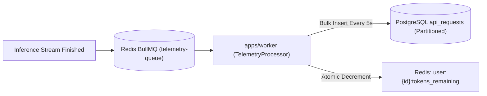

# Phase 09: Telemetry, Usage Tracking & Analytics

## 1. Objective
Implement high-throughput, non-blocking telemetry ingestion. Buffer token metrics and request metadata in Redis upon inference completion, batch-inserting into partitioned PostgreSQL tables via BullMQ to achieve zero impact on inference latency.

---

## 2. Deliverables Checklist
- [ ] Telemetry Ingestion Pipeline:
  - On inference stream termination, gateway pushes event to Redis BullMQ queue: `telemetry-ingest-queue`.
  - Event payload: `{ userId, apiKeyId, modelId, endpoint, promptTokens, completionTokens, latencyMs, ttftMs, statusCode }`.
- [ ] BullMQ Batch Processor (`apps/worker/src/processors/telemetry-batch.processor.ts`):
  - Ingests events in micro-batches (e.g. 100 records or every 5 seconds).
  - Bulk inserts records into the `api_requests` partitioned table.
- [ ] PostgreSQL Rollup & Analytics Views:
  - Materialized views / cron aggregations for:
    - Daily token consumption per user & per model.
    - Hourly latency percentiles (p50, p95, p99).
- [ ] User Quota Real-Time Decrement:
  - Atomic Redis decrement of user's remaining monthly token balance.
  - Automatically reject requests when remaining tokens reach zero with `insufficient_quota`.

---

## 3. Architecture Diagram

---

## 4. Acceptance Criteria
1. Gateway completes HTTP request without waiting for database disk writes.
2. 500 simultaneous streaming requests result in exact token accounting with zero dropped records.
3. Once user quota is exhausted, subsequent requests receive HTTP 429 Insufficient Quota.

