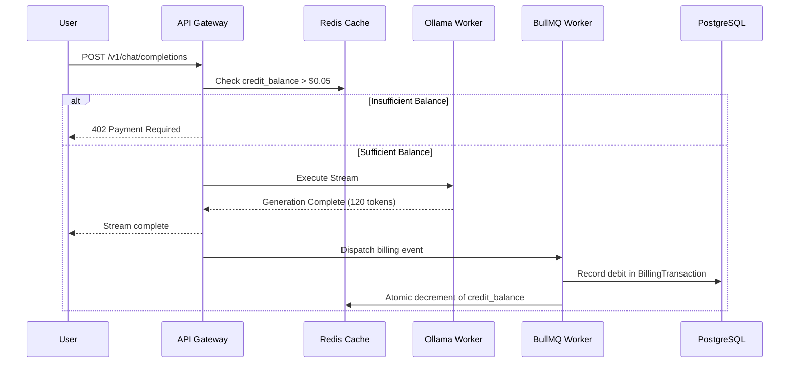

# Phase 11: Billing & Monetization Architecture

## 1. Objective
Design and implement a modular monetization engine supporting prepaid credit balances, token-based pricing per model family, and Stripe payment webhook integrations, kept completely decoupled from the core inference path.

---

## 2. Deliverables Checklist
- [ ] Database Billing Entities:
  - `CreditBalance`: Available USD or credit units per user.
  - `BillingTransaction`: Ledger of purchases, refunds, and usage debits.
  - `ModelPricing`: Per-model cost per 1M input tokens and 1M output tokens.
- [ ] Prepaid Balance Management (`apps/api/src/modules/billing/`):
  - Pre-flight balance check: Ensure user has sufficient funds for estimated maximum tokens.
  - Post-inference settlement: Calculate exact compute charge based on model rates:
    $$\text{Cost} = (\text{Input Tokens} \times \text{Rate}_{\text{input}}) + (\text{Output Tokens} \times \text{Rate}_{\text{output}})$$
- [ ] Stripe Webhook Integration:
  - Stripe Checkout Session for buying credit packs ($10, $50, $200).
  - Webhook listener `POST /api/billing/webhook/stripe`: Credits balance upon successful payment.
- [ ] Frontend Billing UI (`apps/web/app/(dashboard)/billing/`):
  - Current balance card and auto-recharge toggle.
  - Invoices and transaction history table.

---

## 3. Modular Billing Flow

---

## 4. Acceptance Criteria
1. When balance drops to 0, API requests return HTTP 402 Payment Required.
2. Verified Stripe test webhooks immediately top up user credit balance.
3. System remains functional even if billing module is disabled via configuration (`FEATURE_BILLING_ENABLED=false`).

